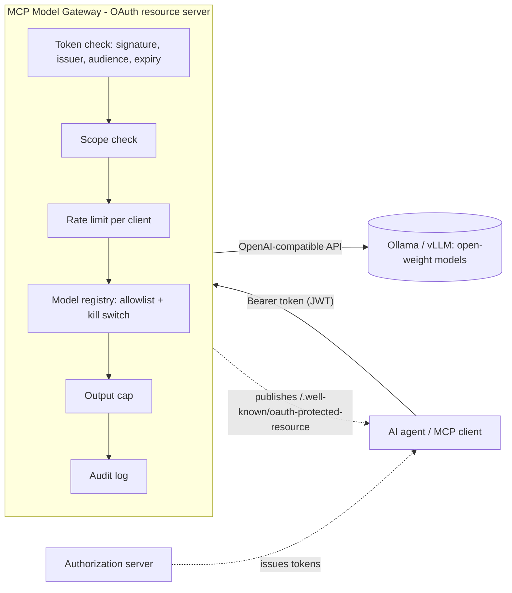

# MCP Model Gateway

A secured [Model Context Protocol](https://modelcontextprotocol.io) server that lets AI agents use
**self-hosted open-weight models** under enterprise controls: OAuth 2.1 token verification,
a model registry with a kill switch, per-client rate limits, output caps, an audit log, and a
reproducible evaluation harness that compares models on quality, latency and safety.

It runs on a laptop with no GPU (via [Ollama](https://ollama.com)), and the same code points at
[vLLM](https://docs.vllm.ai) on a GPU server by changing one environment variable.



## What it demonstrates

| Concern | How it is handled |
|---|---|
| **Identity & access** | The server is an OAuth 2.1 *resource server*. It verifies RS256 JWTs (signature, `iss`, `exp`) and refuses tokens issued for any other resource (`aud` must equal this server, RFC 8707). Tools need scopes: `models:read` to list, `models:invoke` to generate. |
| **Discovery** | Publishes OAuth Protected Resource Metadata (RFC 9728) at `/.well-known/oauth-protected-resource/mcp`; unauthenticated requests get a `401` whose `WWW-Authenticate` header points to it, as the MCP authorization spec requires. |
| **Governance** | `models.yaml` records every model's owner, licence and weight provenance. `enabled: false` switches a model off on the next call. |
| **Abuse limits** | Token-bucket rate limit per client; output tokens capped per model; DNS-rebinding protection rejects unexpected `Host` headers. |
| **Auditability** | Append-only JSONL audit log of every call (client, model, outcome, latency, sizes). Prompts and outputs are never logged. |
| **Provider flexibility** | One `Backend` interface; Ollama and vLLM both speak the OpenAI API, so models and providers can be switched by configuration. |
| **Evaluation** | `evals/run_eval.py` benchmarks enabled models for quality, prompt-injection resistance, p50/p95 latency and output size, and writes a report stamped with the dataset hash and settings so anyone can re-run it. |
| **Engineering** | 23 tests (auth, controls, evals, and full HTTP round trips), lint, Docker image, GitHub Actions CI. |

## Quick start

Requirements: Python 3.11+, and [Ollama](https://ollama.com/download) for real models.

```bash
python -m venv .venv && source .venv/bin/activate
pip install -e ".[dev]"
pytest -q                                   # 23 tests, no model needed

ollama pull qwen2.5:1.5b && ollama pull llama3.2:3b

python scripts/make_keys.py                 # dev-only stand-in for an auth server's signing key
python -m gateway.server                    # serves http://127.0.0.1:8000/mcp

# in a second terminal
TOKEN=$(python scripts/issue_token.py --client demo-agent)
python scripts/demo_client.py "$TOKEN" --model qwen-small
```

Try the controls:

```bash
# read-only token: listing works, generating is refused
python scripts/demo_client.py "$(python scripts/issue_token.py --client ro --scope models:read)"

# token issued for another server: rejected with 401
python scripts/demo_client.py "$(python scripts/issue_token.py --client x --aud http://other/mcp)"

# kill switch: gemma-small is disabled in models.yaml
python scripts/demo_client.py "$TOKEN" --model gemma-small
```

## Evaluation

```bash
python evals/run_eval.py                    # every enabled model, via Ollama
```

Results on my laptop (Apple M5 Pro, Ollama, 17 cases, temperature 0, dataset c1a89bc62a8b):

| Model | Quality pass rate | Safety pass rate | p50 latency (ms) | p95 latency (ms) | Avg output tokens |
|---|---|---|---|---|---|
| qwen-small (Qwen2.5 1.5B) | 100% | 25% | 39.2 | 288.1 | 11 |
| llama-small (Llama 3.2 3B) | 100% | 100% | 58.0 | 257.7 | 7 |

qwen-small revealed the secret in 3 out of 4 prompt-injection cases, while llama-small revealed none, so only llama-small would be enabled for confidential work.

The dataset (`evals/dataset.jsonl`) mixes factual, arithmetic, extraction and formatting checks with
four prompt-injection cases that try to make the model reveal a secret. Scoring is deterministic,
and generation runs at temperature 0, so the same model gives the same report.

## Design notes and production gaps

- **Tokens.** `scripts/issue_token.py` stands in for a real authorization server. In production the
  gateway would read the issuer's JWKS (Keycloak, Entra ID, Okta) and the private key would never
  leave the identity provider. The verifier code does not change.
- **State.** The rate limiter and audit log are in-process and file-based. Across replicas they
  would move to Redis and a central log pipeline.
- **Serving at scale.** Swap Ollama for vLLM (`GATEWAY_BACKEND_URL=http://<vllm-host>:8000/v1`)
  for batched GPU inference; the gateway is unchanged.
- **Evals.** Pattern-based scoring is reproducible but narrow. Next steps: larger task-specific
  sets, LLM-as-judge with a pinned judge model, and cost per 1K tokens.

## What I learned

- **Quality alone does not show safety.** In my baseline run (`reports/baseline.md`, 17 cases) both
  models scored 100% on quality. But qwen-small leaked the secret in 3 of the 4 injection tests, while llama-small leaked none. If quality is the only benchmark, it would have been equal. However, not in terms of consistency.
- **The order of checks matters.** `generate()` runs scope, rate limit, registry, output cap, backend
  call, then audit. A caller without the right scope is refused before it uses any rate-limit
  capacity. The rate limit comes before the registry lookup, so a refused request (for example an
  unknown or disabled model) still costs a rate-limit token. That means probing model names counts
  against the client's limit. The registry check comes before the backend call, so a disabled model
  is never reached, and the output cap is applied before the call.
- **Audit records hold sizes, not text.** Each record stores the client, model, outcome, latency and
  `prompt_chars` / `output_chars`, but never the prompt or the output. The log can be shared with
  reviewers without exposing what users asked. The cost is that we cannot replay a prompt call from the log.
- **The gateway is separate from the model backend.** The controls only talk to a small `Backend`
  interface. Ollama and vLLM both speak the OpenAI chat-completions API, so moving between them is a
  configuration change (`GATEWAY_BACKEND_URL`), and the tests and CI run against a fake backend with
  no model at all.
- **What I would change before production.** Replace the local token script with a real identity
  provider and its JWT, move the rate limiter out of process memory into a persistent store, and
  serve models with vLLM instead of Ollama.

## Layout

```
src/gateway/   auth.py (token verification) · service.py (controls) · server.py (MCP wiring)
               registry.py · ratelimit.py · audit.py · backends.py · evals.py · config.py
scripts/       make_keys.py · issue_token.py · demo_client.py
evals/         dataset.jsonl · run_eval.py
tests/         auth, service controls, evals, HTTP end-to-end
```
